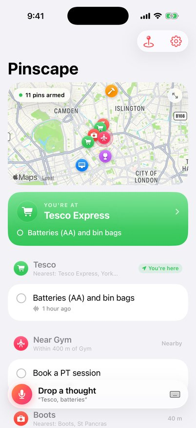
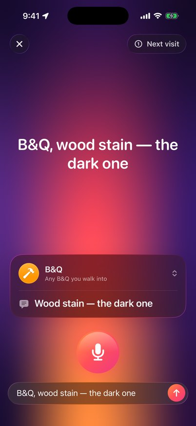
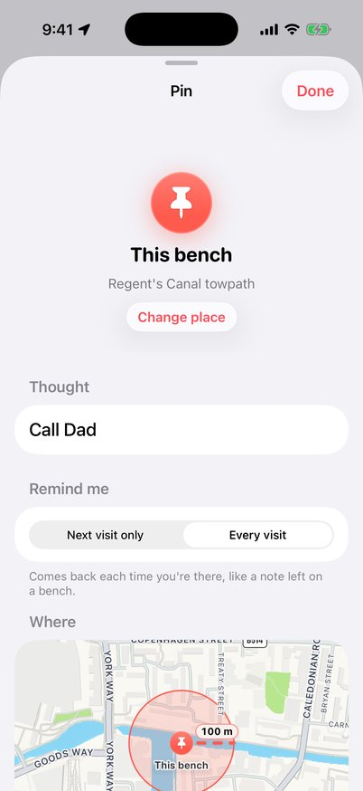
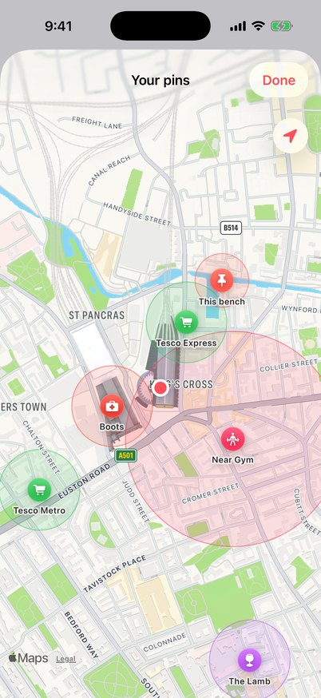
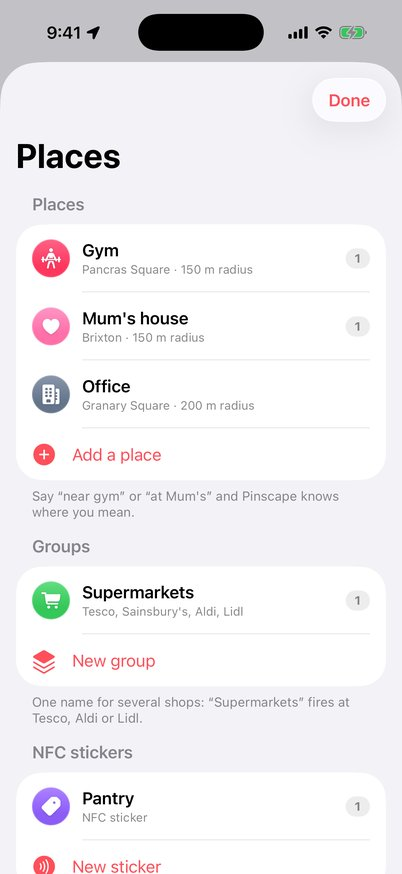
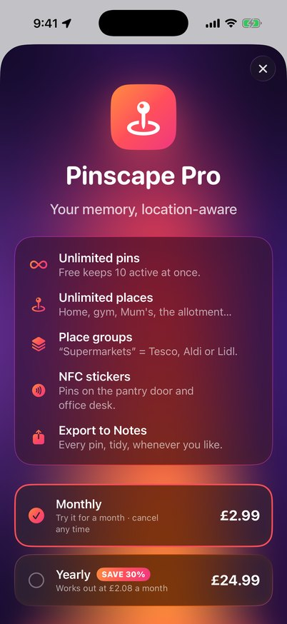
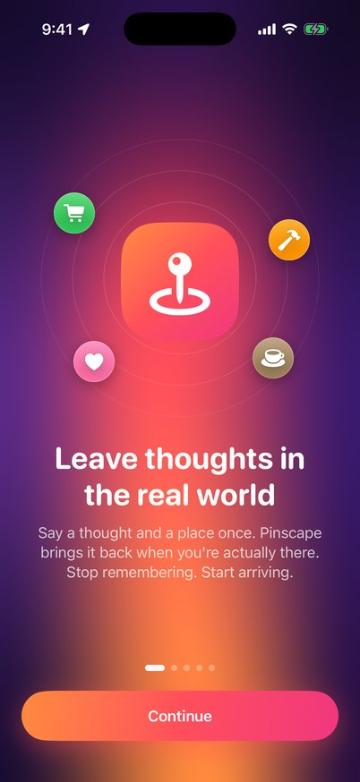
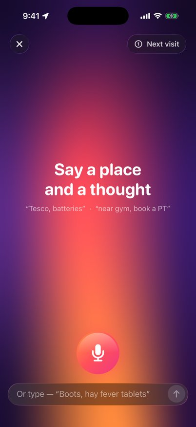
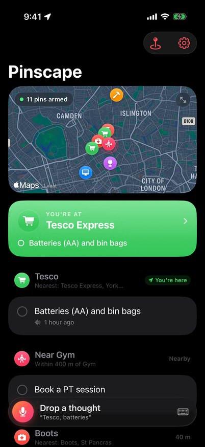

# Pinscape

**Leave thoughts in the real world.**

Pinscape lets you drop voice or text notes tied to real-world places, then surfaces them automatically when you're actually there. No lists, no planning, no "Hey Siri".

> *Walk into any B&Q and your Lock Screen shows: "wood stain — the dark one".*

**Core loop:** capture in 2 seconds → forget about it → get reminded at exactly the right moment.

---

## What's in the box

| | |
|---|---|
| **Frictionless capture** | Action Button, Back Tap, Lock Screen widget, Control Center control, Siri, Share Sheet. Voice first with the text field always visible. A two-beat haptic and a soft chime so you feel it land without looking, then a spoken confirmation ("Got it. Tesco, batteries.") and **shake to undo**. |
| **Fuzzy places, not addresses** | "Tesco" means *any* Tesco. "Any pharmacy" means the nearest one. "Near gym" is 400 m around your saved gym. "Downtown" is 1 km around your town centre. "This bench" is where you're standing. "Pub near office" finds the pub closest to your office. All through Apple Maps. No postcodes. |
| **Smart suggestions, zero admin** | Say "wood stain" and Pinscape suggests B&Q. Share a screenshot with "Currys" on it and Pinscape reads it on device and suggests Currys. Share an IKEA product link and it suggests IKEA. Your calendar spots trips: "Off to Bristol on Saturday. Any pins to drop?" |
| **Next visit or every visit** | New pins remind you on your **next visit only**, then wait in your list (re-arm with one tap). Switch a pin to **every visit** for ambient notes like "this bench = call dad", which come back each time you're there. |
| **Live Activities** | When you arrive somewhere with pins, a checklist appears on the Lock Screen and in the Dynamic Island. Tick things off without unlocking. |
| **Widgets** | A Lock Screen capture button, waiting pins on the Lock Screen and Home Screen, and interactive tick-off buttons. |
| **Private by design** | On-device-only speech recognition, an encrypted store on the phone, no account, no Pinscape servers, no analytics, no location history. Finding shops uses Apple Maps. See [Privacy in detail](#privacy-in-detail). |
| **Pro** | Unlimited pins and places, place groups ("Supermarkets" = Tesco, Aldi or Lidl), NFC stickers for pantry and office, export to Notes. StoreKit 2 with a local StoreKit config for testing. |

It uses the native frameworks Apple already built: **App Intents, ActivityKit (Live Activities), WidgetKit (including Control widgets), Core Location (`CLMonitor`), MapKit, Speech, AVFoundation, Vision, NaturalLanguage (on-device word embeddings), EventKit, Core NFC, StoreKit 2, SwiftData and TipKit.** On iOS 26 it adopts Liquid Glass. It runs on iOS 18 and later.

## Screenshots

Captured automatically on GitHub's macOS runner from the iOS 26 simulator (iPhone 17 Pro).

| Home | Capture | Pin |
|:---:|:---:|:---:|
|  |  |  |
| **Watched places** | **Your places** | **Pro** |
|  |  |  |
| **Welcome** | **Say it** | **Dark mode** |
|  |  |  |

Every push to `main` re-captures these from a fresh build and publishes them to the [`ci/screenshots`](../../tree/ci/screenshots) branch.

## How it works

### Capture
`CaptureParser` (in `Shared/Core`) splits what you said into a **place** and a **thought**. It understands:

```
Tesco, batteries                         → Tesco · "Batteries"
wood stain the dark one at B&Q           → B&Q · "Wood stain the dark one"
when I'm in Bristol try Sarah's café     → Bristol · "Try Sarah's café"
near gym, book a PT session              → near Gym (400 m) · "Book a PT session"
this bench = call dad                    → This bench · "Call dad" (every visit)
any pharmacy: hay fever tablets          → Any pharmacy · "Hay fever tablets"
```

Then `PlaceResolver` turns the phrase into a `PlaceTarget`: a chain (any branch), a kind of place, one of your saved places, a spot, an area, a place group or an NFC sticker.

### Surfacing: getting around the 20-region limit
iOS only lets an app watch 20 regions, but "any Tesco" can mean hundreds of shops. `GeofencePlanner` keeps the **19 nearest** candidate places watched and draws a **boundary circle** around you. Leaving the boundary wakes Pinscape, which searches Apple Maps for the nearest branches again and swaps them in. Significant location changes act as a backstop.

A temporary failure never disarms a reminder that was working. If an Apple Maps search fails, that chain keeps the branches it was already watching. Without a location fix, nothing already watched is touched, and if the pins can't be read the plan isn't changed at all. Pinscape then tries again a few minutes later.

When a region fires, iOS relaunches Pinscape in the background for a few seconds. `ArrivalCoordinator` matches the region to your pins and applies `SurfacingPolicy`: a next-visit pin surfaces once and then disarms (so it stops using one of the 20 slots), and an every-visit pin rests for a few hours between visits so popping in and out doesn't nag. It posts a time-sensitive notification with **Done** and **Next visit** actions and starts the Live Activity checklist. It saves the fact that the pins surfaced *before* showing anything, so a reminder can't repeat because of a failed save. If saving fails, or the phone hasn't been unlocked since a restart, the arrival waits and is retried for as long as you're still there.

### Data
Pins and places live in SwiftData inside the App Group container, so the app, widgets and share extension share one store. The store is protected with iOS Data Protection (`completeUntilFirstUserAuthentication`), which keeps it encrypted at rest while still letting an arrival be handled with the phone locked. Nothing syncs anywhere.

## Privacy in detail

Pinscape has no servers, accounts, analytics or third-party SDKs. What stays on the iPhone and what goes to Apple:

| | Where it's handled |
|---|---|
| Your voice | On the iPhone only (`requiresOnDeviceRecognition`). If the on-device model isn't available for your language, voice capture is switched off and you type instead. |
| Pins, places, stickers | An encrypted SwiftData store in the App Group container. Never synced. |
| Where you are | iOS watches your pinned places on the device and wakes Pinscape on arrival. Pinscape keeps no location history; it stores only the last known position (to rank nearby shops) and the regions it's watching. |
| Finding shops and addresses | Apple Maps (`MKLocalSearch`), which receives the search text and the map area around you, as in the Maps app. Street and town names for "here" and "downtown" come from Apple's reverse geocoder. |
| Calendar trips | Read on the device. An event whose location has no coordinates is looked up in Apple Maps. |
| Screenshots you share | Text recognition with Vision, on the device. |
| Purchases | StoreKit and the App Store. |

Pinscape itself collects nothing, so its App Store privacy label should be "Data Not Collected"; Apple Maps and App Store requests are handled by Apple under Apple's privacy policy.

## Project layout

```
Pinscape/            The app: screens, services (location, speech, StoreKit, NFC, calendar), App Intents
PinscapeWidgets/     Widgets, the Control Center / Action Button control, the Live Activity
PinscapeShare/       Share extension with on-device text recognition
Shared/Core/         Platform-independent logic: parser, brand catalog, planner, policies
Shared/Store/        SwiftData models and the App Group store
Shared/UI/           Colours, place glyphs, chips (used by app and extensions)
Shared/Activity/     Live Activity attributes and intents shared with the widget extension
PinscapeTests/       Tests for the core logic
project.yml          XcodeGen spec that generates Pinscape.xcodeproj
```

## Running it

You need a Mac with **Xcode 26** or later.

1. Open `Pinscape.xcodeproj`.
2. In **project.yml** (or the project's build settings) change `PINSCAPE_BUNDLE_ID` and `PINSCAPE_APP_GROUP` to identifiers you own, e.g. `com.yourname.pinscape` and `group.com.yourname.pinscape`.
3. Select the **Pinscape** target, open **Signing & Capabilities**, and pick your team. Do the same for **PinscapeWidgets** and **PinscapeShare**.
4. Run on your iPhone. When asked, allow location **Always** and notifications.

To try purchases in the simulator, the Pinscape scheme already uses `Pinscape/Resources/Pinscape.storekit`.

To see the app with sample data, add the launch arguments `-PinscapeDemo YES` and optionally `-PinscapeScreen capture` (or `places`, `settings`, `paywall`, `onboarding`, `pin`, `here`, `map`). Demo mode is Pro; add `-PinscapeFree YES` to see the free tier, or `-PinscapeFirstPin YES` to see Home right after a first capture.

> **Free Apple developer accounts:** App Groups, NFC and Time Sensitive notifications need a paid membership. With a free account, remove those capabilities from the three `.entitlements` files to run on your own phone; widgets and the share extension then keep their own separate data.

### Setting up quick capture on your phone
- **Action Button:** Settings › Action Button › Controls › Pinscape › *Drop a Pin*.
- **Back Tap:** Settings › Accessibility › Touch › Back Tap › Double Tap › *Drop a Pin*.
- **Lock Screen:** customise your Lock Screen and add the *Drop a Pin* control or widget.
- **Siri:** "Leave a thought with Pinscape", "What's pinned here in Pinscape?"

### Regenerating the project
`Pinscape.xcodeproj` is generated from `project.yml`. After adding or moving files:

```sh
brew install xcodegen
xcodegen
```

### Tests
The core logic runs anywhere Swift does, including Linux:

```sh
swift test
```

In Xcode, ⌘U runs the same tests on the simulator.

## Built on GitHub's Macs

`.github/workflows/ios.yml` runs on every push:

- **Core tests** on Linux (`swift test`).
- **Release archive**: an unsigned device archive of the app and both extensions, checked for their resources.
- **Build, test & screenshots** on GitHub's `macos-26` runner with Xcode 26: builds the app and both extensions, runs the unit tests on an iPhone 17 Pro simulator (the StoreKit tests on iOS 26.2, because StoreKit testing is broken on the 26.4 and 26.5 simulators), then launches the app in demo mode and captures screenshots of each screen in light and dark mode. The simulator build is attached to each run as `Pinscape-simulator` (drag it onto a booted simulator to install).

### TestFlight from GitHub
`.github/workflows/testflight.yml` archives, signs and uploads to TestFlight from the macOS runner, so you never need your own Mac to get Pinscape on your phone.

1. Create the app in [App Store Connect](https://appstoreconnect.apple.com) with your bundle ID.
2. Create an App Store Connect API key with the **Admin** role (Users and Access › Integrations).
3. In this repo's **Settings › Secrets and variables › Actions**, add:
   - Secrets: `ASC_KEY_ID`, `ASC_ISSUER_ID`, `ASC_KEY` (the full contents of the `.p8` file), `TEAM_ID`.
   - Variables: `PINSCAPE_BUNDLE_ID`, `PINSCAPE_APP_GROUP`.
4. Run **Actions › TestFlight › Run workflow**.

## Pricing

| | |
|---|---|
| Free | 10 active pins, 1 saved place |
| Pro | **£2.99/month** (or £24.99/year, save 30%): unlimited pins and places, place groups, NFC stickers, export to Notes |
| Sticker Pack | £9.99 once: NFC sticker pins for pantry and office |

Product IDs: `com.pinscape.pro.monthly`, `com.pinscape.pro.yearly`, `com.pinscape.stickerpack`. Create them in App Store Connect with the same IDs.

## What iOS doesn't allow (and what Pinscape does instead)

- **Reading your Google searches.** Apps can't see Safari or Google history. Instead, share a product page or screenshot to Pinscape and it suggests the shop (IKEA links, Currys screenshots, and so on).
- **Starting a Live Activity from the background.** iOS only allows this while the app is open. The arrival notification always goes out; the checklist starts as soon as you open the notification or the app.
- **Waking on an NFC tap without the app.** Tap a sticker with Pinscape open, or add a Shortcuts automation (When NFC tag is scanned › *Open Sticker Pins*) for a hands-free tap.

---

*Stop remembering. Start arriving.*
